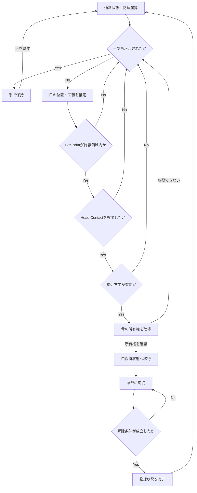

# VRChat 骨の口保持ギミック 設計書

## 1. 全体設計

### 1.1 目的と基本方針

既存の **VRC Pickup** による手での保持機能を維持しながら、**アバターの口で骨を拾い、頭部の動きに追従させる機能**を追加する。

実装には **UdonSharp** を使用し、**アバター側の改変やユーザーによるキャリブレーションを必要としない**構成を目指す。

| 項目 | 設計方針 |
|---|---|
| 口の位置推定 | Head Tracking基準のオフセットにスケール・骨格補正を統合 |
| 形状差への対応 | 口の周囲に楕円体の取得許容領域を定義 |
| 接触検出 | 標準Head Contactとワールド側Contact Receiverを利用 |
| 接近方向 | 頭部前方ベクトルと口・骨の相対速度ベクトルから判定 |
| 速度制限 | 任意の正の最小速度は設けず、前方への接近を条件とする（$v_{\parallel}>0$） |
| 口での保持 | 骨のBitePointを推定口位置に一致させ、頭部に追従 |
| 手での保持 | 既存のVRC Pickupを維持 |
| マルチプレイヤー | 所有者が骨の位置・回転を更新 |
| キャリブレーション | 採用しない |

### 1.2 システム構成

| モジュール | 入力 | 出力 |
|---|---|---|
| M1. 口位置推定 | Head Tracking、Head Bone、アバタースケール | 推定口位置・回転 |
| M2. 取得候補判定 | 推定口位置、骨の位置、Head Contact | 取得候補か |
| M3. 接近方向判定 | 口と骨の相対速度、頭部前方ベクトル | 接近方向が有効か |
| M4. 保持制御 | 口位置・回転、保持状態、BitePoint | 骨の目標位置・回転 |
| M5. 状態・同期管理 | Pickupイベント、所有権、入力 | 状態遷移・ネットワーク同期 |

**取得判定（M1〜M3）と保持制御（M4）を分離する。** 口で保持した後は、取得用のContact・速度条件が失われても保持を継続する。

### 1.3 全体処理フロー



> この図は論理的な処理順序を示す。実際にはContactイベントと位置・速度更新のタイミングが異なるため、各判定値を適切に保持する必要がある。口保持から手保持への直接遷移は下の状態表で別途扱う。

### 1.4 状態遷移

- $S_0$：通常状態（Free）
- $S_1$：手で保持（HandHeld）
- $S_2$：口で保持（MouthHeld）

| 現在の状態 | イベント | 次の状態 |
|---|---|---|
| $S_0$ | 手でPickup | $S_1$ |
| $S_0$ | 口による取得条件成立、所有権取得成功 | $S_2$ |
| $S_1$ | 手からDrop | $S_0$ |
| $S_2$ | 口から離す操作 | $S_0$ |
| $S_2$ | 手でPickup | $S_1$ |
| $S_2$ | 保持者退出などで保持継続不能 | $S_0$（復旧処理） |

口保持中は、Contactが失われても保持を継続する。解除直後の再取得を防ぐためにクールダウンを設ける。手から口への直接受け渡しは初期実装では対象外とする。

### 1.5 Unityオブジェクト構成

```text
Bone
├── Mesh
├── Rigidbody
├── Collider
├── VRC Pickup
├── VRC Object Sync
├── MouthPickupController (UdonSharp)
└── BitePoint (Transform)
    └── HeadContactReceiver
        ├── VRC Contact Receiver
        └── MouthContactDetector (UdonSharp)
```

`BitePoint` は骨をくわえる位置を表す。`HeadContactReceiver` はその付近に配置し、接触イベントを `MouthPickupController` に通知する。構成・イベント名・受信条件は使用するVRChat SDKバージョンで検証する。

---

## 2. 数学的モデルの全体像

### 2.1 記号

| 記号 | 意味 |
|---|---|
| $\mathbf{p}_H,R_H$ | Head Trackingの位置・回転 |
| $\mathbf{p}_B$ | Head Boneの位置 |
| $s$ | アバタースケール比 |
| $\mathbf{p}_m$ | 推定口位置 |
| $\mathbf{p}_b$ | 骨のBitePointの位置 |
| $\mathbf{f}$ | 頭部前方の単位ベクトル |
| $\mathbf{v}_m,\mathbf{v}_b$ | 口およびBitePointの速度 |
| $\mathbf{v}_r$ | 骨の口に対する相対速度 |
| $\mathbf{o}_0$ | 基準口位置の固定オフセット |
| $\mathbf{d}_0$ | 基準Head Boneの相対位置 |
| $\alpha,\beta$ | スケール・骨格補正係数 |
| $r_x,r_y,r_z$ | 取得許容領域の各軸半径 |
| $\theta_{\max}$ | 接近方向の許容角度 |
| $C_H$ | Head Contactの有効状態 |
| $C_F$ | 手で保持されていない条件 |

位置と速度はワールド座標で扱い、$R_H$ は頭部ローカル座標からワールド座標への回転とする。

### 2.2 口位置推定（A・B・Cの統合）

$$
\mathbf{p}_m=\mathbf{p}_H+R_H\mathbf{o}_m
\tag{1a}
$$

$$
\begin{aligned}
\mathbf{o}_m
={}&[1+\alpha(s-1)]\mathbf{o}_0\\
&+\beta\left[R_H^{-1}(\mathbf{p}_B-\mathbf{p}_H)-s\mathbf{d}_0\right]
\end{aligned}
\tag{1b}
$$

- $\alpha=\beta=0$：固定オフセット（方式A）。
- $\alpha=1,\ \beta=0$：スケール比をそのまま適用（方式B）。
- $\beta\ne0$：骨格の相対位置による補正を追加（方式C）。

### 2.3 口の取得許容領域

$$
\mathbf{u}=R_H^{-1}(\mathbf{p}_b-\mathbf{p}_m)
$$

$$
D(\mathbf{u})=
\frac{u_x^2}{r_x^2}+\frac{u_y^2}{r_y^2}+\frac{u_z^2}{r_z^2}
\tag{2}
$$

$$
D(\mathbf{u})\le1
\tag{3}
$$

### 2.4 接近方向

$$
\mathbf{v}_r=\mathbf{v}_b-\mathbf{v}_m,
\qquad v_{\parallel}=-\mathbf{v}_r\cdot\mathbf{f}
$$

$$
\mathbf{v}_{\perp}=\mathbf{v}_r+v_{\parallel}\mathbf{f}
\tag{4}
$$

$$
v_{\parallel}>0
\tag{5}
$$

$$
\|\mathbf{v}_{\perp}\|\le v_{\parallel}\tan\theta_{\max}
\tag{6}
$$

ここで **$v_{\min}$ のような正の速度閾値は設けない**。接近方向のみを制限する。

### 2.5 取得条件の統合

前方位置条件を

$$
C_P=\left[(\mathbf{p}_b-\mathbf{p}_m)\cdot\mathbf{f}\ge-\varepsilon\right]
$$

と定める。取得条件の基本形は

$$
\begin{aligned}
G={}&C_F\land C_H\\
&\land[D(\mathbf{u})\le1]\\
&\land[v_{\parallel}>0]\\
&\land[\|\mathbf{v}_{\perp}\|\le v_{\parallel}\tan\theta_{\max}]\\
&\land C_P
\end{aligned}
\tag{7}
$$

である。実装時には、所有権・クールダウン・接触イベントと位置更新のタイミング差も扱う。

---

## 3. 各課題の整理

### 課題1. アバターごとの口位置の違い

**課題**

アバターによって頭部の大きさ、顔の形状、Head Boneの配置が異なるため、HMDからの固定オフセットでは口位置にずれが生じる。

**解決方法**

A・B・Cを単一の推定式に統合し、アバタースケールとHead Boneの相対位置を係数 $\alpha,\beta$ で補正する。ユーザーごとのキャリブレーションは行わない。Bone情報が利用できなければ対応する補正を無効化する。Eye Bone・Jaw Boneを利用する追加方式は保留する。

**定式化**

$$
s=\frac{H}{H_0}
$$

$H$ はアバターの目の高さ、$H_0$ は基準値。口の推定には式(1a)、(1b)を使用する。

### 課題2. 口位置の推定誤差

**課題**

推定口位置と実際の口位置がずれると、点同士の距離に基づく判定では取得に失敗しやすい。

**解決方法**

口周辺に楕円体の取得許容領域を設け、アバタースケールに応じて各軸の半径を変更する。

**定式化**

式(2)、(3)を使用する。半径は

$$
r_i(s)=r_{i,0}[1+\lambda_i(s-1)],\qquad i\in\{x,y,z\}
$$

とする。ただし実装時は各半径を正に保つ。大きな許容領域は取得成功率を上げる一方、誤取得を増やし得る。

### 課題3. 口以外での誤取得

**課題**

口の推定領域内に骨があっても頭に接触していない可能性があり、Head Contactだけでは口・額・頬などを区別できない。

**解決方法**

骨のBitePoint付近のContact Receiverで標準 `Head` Contactを検出し、楕円体領域判定と併用する。取得判定は対象プレイヤーのローカル環境で行う。

**定式化**

$$
C_H(t)=
\begin{cases}
1 & \text{Head Contactが有効},\\
0 & \text{それ以外}
\end{cases}
$$

$$
C_{\mathrm{candidate}}=C_H(t)\land[D(\mathbf{u})\le1]
$$

接触だけで取得せず、さらに接近方向を判定する。

### 課題4. 接近方向の判定

**課題**

領域判定とHead Contactが成立しても、骨が横方向へ通過したり、口から離れたりしている可能性がある。

**解決方法**

骨と口の相対速度を頭部前方・垂直方向に分解し、前方から近づく運動だけを許可する。固定の最小接近速度は設定しない。

**定式化**

$$
\mathbf{v}_m(t)\approx
\frac{\mathbf{p}_m(t)-\mathbf{p}_m(t-\Delta t)}{\Delta t},
\quad
\mathbf{v}_b(t)\approx
\frac{\mathbf{p}_b(t)-\mathbf{p}_b(t-\Delta t)}{\Delta t}
$$

相対速度を式(4)〜(6)で判定する。必要に応じて、口の中心との距離が縮まる追加条件

$$
(\mathbf{p}_b-\mathbf{p}_m)\cdot\mathbf{v}_r<0
\tag{8}
$$

も評価する。これは前方への運動と中心への接近を区別するが、推定中心が実際の口とずれていると取得しにくくなる可能性がある。

### 課題5. トラッキングノイズと判定タイミング

**課題**

位置の時間差分で求める速度はノイズに弱く、またContactイベントと位置更新が異なるタイミングで発生する。

**解決方法**

相対速度に平滑化を適用し、接近方向が成立した履歴を短時間だけ保持する。現在の領域・状態判定を省略しない。

**定式化**

$$
\hat{\mathbf{v}}_r(t)
=\eta\mathbf{v}_r(t)
+(1-\eta)\hat{\mathbf{v}}_r(t-\Delta t),
\qquad 0<\eta\le1
$$

最後に接近条件が成立した時刻を $t_v$ とし、

$$
0\le t-t_v\le\tau
$$

である場合にのみ、その判定を一時的に有効とする。履歴保持中も現在の接触・許容領域・所有権を確認する。

### 課題6. くわえた後の位置・姿勢制御

**課題**

骨のルートを口に一致させるだけでは、BitePointが口元に一致せず不自然な保持姿勢になる。

**解決方法**

口保持中は骨をKinematicに切り替え、BitePointが推定口位置に一致するように骨の位置・回転を更新する。頭部IK更新後のタイミングで追従させる。

**定式化**

骨ルートのワールド位置・回転を $\mathbf{p}_O,R_O$、BitePointのローカル位置・回転を $\mathbf{b},R_b$、頭部に対する目標保持回転を $R_g$ とする。

$$
R_O=R_HR_gR_b^{-1}
\tag{9}
$$

$$
\mathbf{p}_O=\mathbf{p}_m-R_O\mathbf{b}
\tag{10}
$$

式(10)は骨のローカルスケールが単位である場合の式。スケールがある場合はローカル点のスケール変換を含める。

### 課題7. 手と口の操作競合

**課題**

VRC Pickupと口保持が同時にTransformを更新すると、競合して不安定な動作になる。

**解決方法**

手保持と口保持を排他的な状態として扱う。手のPickupイベントが発生したら口追従を停止し、操作権をPickupに移す。手で持たれている骨は口で取得しない。

**定式化**

手保持 $H\in\{0,1\}$、口保持 $M\in\{0,1\}$ に対し、

$$
H+M\le1
$$

を不変条件とする。

| 状態 | 位置制御 | Rigidbody |
|---|---|---|
| 通常 | 物理演算 | Dynamic |
| 手保持 | VRC Pickup | Pickup側の制御 |
| 口保持 | UdonSharp | Kinematic |

口保持解除の入力方式は仮仕様（Use入力）とし、誤解除や操作競合がないか検証する。

### 課題8. マルチプレイヤー同期

**課題**

同時取得や保持者の退出によって、所有権と保持状態が不整合になる可能性がある。途中参加者にも状態を共有する必要がある。

**解決方法**

所有者だけが骨のTransformを更新する。保持状態と保持者IDは同期変数で管理し、位置・回転および物理状態はVRC Object Syncで共有する。所有権移動後の通知順序・競合を実機で検証する。

**定式化**

保持状態 $S$、保持者ID $I_h$、所有者ID $I_o$ に対し、

$$
S=S_2\implies I_h=I_o
\tag{11}
$$

を維持する。ローカルクライアントでの更新許可条件は、

$$
C_{\mathrm{update}}
=[S=S_2]\land[I_h=I_{\mathrm{local}}]\land[I_o=I_{\mathrm{local}}]
\tag{12}
$$

とする。

| 同期対象 | 方法 |
|---|---|
| 骨の位置・回転 | VRC Object Sync |
| Rigidbodyの状態 | VRC Object Sync |
| 保持状態 | UdonSynced |
| 保持者ID | UdonSynced |
| 口の推定位置・速度 | 同期しない（所有者側で計算） |

保持者の退出時には新しい所有者が状態を復旧する。途中参加者には同期変数を用いて保持状態を共有する。

### 課題9. アバター変更とスケール変更

**課題**

アバター変更やスケール変更によって推定口位置が不連続に動き、保持中の骨が瞬間移動する可能性がある。

**解決方法**

変更イベントで推定パラメータを更新する。保持中のアバター変更時は保持解除を基本とし、スケール変更時は係数の再計算と、不連続移動への対策を行う。

**定式化**

アバター変更イベントを $A(t)$ としたとき、

$$
S(t)=S_2\land A(t)\implies S(t^+)=S_0
$$

とする。スケール変更時は

$$
s(t)=\frac{H(t)}{H_0}
$$

を再計算し、口位置推定と領域半径に反映する。

---

## 4. 実装パラメータ

| パラメータ | 用途 | 決定方法 |
|---|---|---|
| $\mathbf{o}_0$ | 基準口位置 | アバター比較実験 |
| $\mathbf{d}_0$ | 基準Head Bone位置 | アバター比較実験 |
| $\alpha$ | スケール補正係数 | 実験 |
| $\beta$ | 骨格補正係数 | 実験 |
| $r_{x,0},r_{y,0},r_{z,0}$ | 取得領域の基本サイズ | 実験 |
| $\lambda_x,\lambda_y,\lambda_z$ | 領域のスケール補正 | 実験 |
| $\theta_{\max}$ | 接近方向の許容角度 | 動作検証 |
| $\varepsilon$ | 後方位置判定の許容値 | 動作検証 |
| $\eta$ | 速度平滑化係数 | ノイズ評価 |
| $\tau$ | 接近判定の履歴保持時間 | 動作検証 |
| $R_g$ | 骨をくわえる際の向き | 骨の形状から設定 |
| $T_c$ | 解除後の再取得禁止時間 | 動作検証 |

これらはギミック制作者が設定する共通パラメータであり、ユーザーごとのキャリブレーション値ではない。

口位置推定の精度と領域の半径は相互に補完する。取得成功率だけでなく、誤取得率も同時に評価する。

---

## 5. 実装・検証計画

| 段階 | 実装内容 | 検証目的 |
|---|---|---|
| Phase 1 | 口位置推定と可視化 | アバター間の推定誤差 |
| Phase 2 | 楕円体領域の可視化・判定 | 形状差の許容範囲 |
| Phase 3 | Head Contact検出 | 接触イベントの動作確認 |
| Phase 4 | 相対速度・方向判定 | 意図しない取得の防止 |
| Phase 5 | 口保持・解除 | 追従精度と状態遷移 |
| Phase 6 | VRC Pickupとの統合 | 操作競合の解消 |
| Phase 7 | マルチプレイヤー同期 | 所有権競合と表示整合性 |

### 5.1 評価指標

**口位置推定誤差**

$$
e_m=\|\hat{\mathbf{p}}_m-\mathbf{p}_m^*\|
$$

$\mathbf{p}_m^*$ は実験で定める実際の口位置。ギミックの実行時には使用しない。

**取得成功率**

$$
R_{\mathrm{grab}}=\frac{N_{\mathrm{success}}}{N_{\mathrm{attempt}}}
$$

**誤取得率**

$$
R_{\mathrm{false}}=\frac{N_{\mathrm{false}}}{N_{\mathrm{negative}}}
$$

**保持位置誤差**

$$
e_h=\|\mathbf{p}_b-\mathbf{p}_m\|
$$

加えて、取得開始までの時間、同期遅延、スケール変更時の追従、複数ユーザーでの所有権競合を検証する。

---

## 6. 残る検討事項

| 項目 | 状況 | 優先度 |
|---|---|---|
| A・B・Cの統合 | 方針確定、係数未決定 | 高 |
| Eye/Jaw Boneの利用 | 採用保留 | 低 |
| 楕円体領域 | 方針確定、半径未決定 | 高 |
| Head Contactの併用 | 方針確定、実機検証待ち | 高 |
| 相対速度による方向制約 | 方針確定、許容角度未決定 | 高 |
| 速度平滑化・時間窓 | 詳細未決定 | 中 |
| 口保持時の骨の向き | 骨形状に応じて設定 | 中 |
| 口保持の解除操作 | 仮仕様 | 中 |
| 手から口への直接受け渡し | 初期実装の対象外 | 低 |
| マルチプレイヤー同期 | 基本設計済み、実機検証待ち | 高 |

### 設計上の結論

本ギミックは、以下の二つの問題に分けて設計する。

1. **どの位置・動作で骨をくわえられるか**：口位置推定、楕円体許容領域、Head Contact、相対速度の接近方向判定で扱う。
2. **くわえた骨をどう保持・共有するか**：BitePointに基づく姿勢制御、VRC Pickupとの排他的状態管理、VRC Object Syncで扱う。

取得判定と保持・同期制御を独立して実装・検証する。まずPhase 1〜4で**アバター改変やキャリブレーションを必要としない取得判定**の信頼性を評価し、その後に保持・同期の実装を進める。

> **備考：** 本書は実装前の設計案である。SDKの接触イベント、標準Contactの実際の挙動、所有権競合の扱い、同期状態の復旧については、使用環境での確認・検証が必要である。
